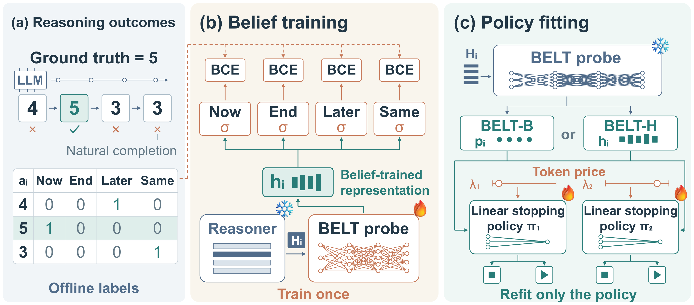
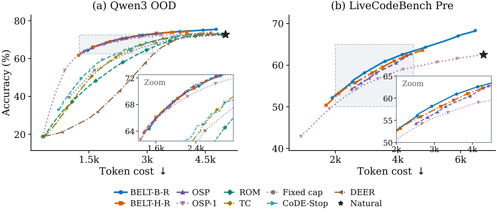

<div align="center">

# BELT: Belief-based Termination

### Same Beliefs, Different Policies: Learning Reusable Representations for Early Stopping in LLM Reasoning

Jingwei Ni · Dmitry Abulkhanov · Vladislav Smirnov · Markus Leippold · Elliott Ash · Timothy Baldwin · Artem Shelmanov · Mrinmaya Sachan

ETH Zürich · MBZUAI · University of Zürich · The University of Melbourne

[](#-checkpoints)
[](#-use-belt-in-thinkbooster)
[](#-train-and-evaluate)

[Overview](#-overview) · [ThinkBooster](#-use-belt-in-thinkbooster) · [Checkpoints](#-checkpoints) · [Train & evaluate](#-train-and-evaluate) · [Repository map](#%EF%B8%8F-repository-map) · [Citation](#-citation)

</div>

---

Reasoning LLMs often keep thinking after they already have a correct answer. **BELT** decides when to stop. It separates *predicting outcomes* from *choosing a stopping policy*: one probe on a frozen LLM's hidden states learns price-independent beliefs about current and future answers, and a small linear policy on those frozen features is fitted on CPU for each accuracy–cost trade-off.

<p align="center">
  
</p>

## ✨ Overview

BELT's probe predicts four beliefs at every reasoning boundary:

| Belief | Question it answers |
| :--- | :--- |
| **Now** | Is the answer I would give right now correct? |
| **End** | Will the answer at natural completion be correct? |
| **Later** | Can a later answer still be correct? |
| **Same** | Will the current answer stay the same until the end? |

The stopping policy reads either the four beliefs (**BELT-B**) or the probe's 768-dimensional belief-trained representation (**BELT-H**). Changing the token price only refits this linear policy, or shifts its threshold; the probe is trained once.

**Highlights from the paper**

- 📉 **41% / 51% fewer generated tokens** on Qwen3-1.7B / OLMo-3-7B-Think, averaged over five out-of-distribution math benchmarks, at matched test-frontier accuracy relative to natural completion.
- ⚖️ **Matches the five-checkpoint OS-Pruner** on Qwen3 and exceeds it on OLMo3 mathematics. It saves more tokens than the single-checkpoint OSP-1 at every reported accuracy tolerance across all seven math and coding settings.
- 💻 **Transfers to code** on both backbones without code-side training.
- 🎮 **Controls agent thinking** in ALFWorld and ScienceWorld, saving 85% of ScienceWorld tokens at or above the natural score.
- 🪶 **6.3× fewer controller parameters** than one OSP checkpoint on Qwen3.

<p align="center">
  
</p>

## 🚀 Use BELT in ThinkBooster

BELT is integrated into **[ThinkBooster](https://github.com/IINemo/thinkbooster)**, a unified framework for test-time scaling of LLM reasoning, through **[PR #264](https://github.com/IINemo/thinkbooster/pull/264)** (merged). The integration adds:

- **`StepScorerBELT`** scores a reasoning prefix and returns the four beliefs plus the 768-dimensional representation.
- **`StrategyBELT`** is an early-stopping strategy. It applies a fitted linear stopping policy, closes thinking when the policy stops, and requests the final answer.
- **Hydra configs** run MATH-500 with Qwen3-1.7B (`experiments/belt/math500_qwen3_1p7b`, plus a shared vLLM backend variant).

The default probe is the ReProbe-initialized Qwen3-1.7B checkpoint below; both initialization families and all three seeds are selectable.

```bash
git clone https://github.com/IINemo/thinkbooster.git && cd thinkbooster
pip install -e ".[belt]"
```

```python
from thinkbooster.scorers import StepScorerBELT

scorer = StepScorerBELT(
    checkpoint_repo="JingweiNi/BELT-Qwen3-1.7B-ReProbeInit",
    seed=0,
    device="cuda:0",
)
chat = [{"role": "user", "content": "What is 17 + 25?"}]
steps = ["17 + 20 = 37.\n\n", "37 + 5 = 42.\n\n"]
signal = scorer.score_prefix(chat, steps)
print(signal.beliefs)      # Now / End / Later / Same
print(len(signal.hidden))  # 768
```

The **[ThinkBooster BELT guide](https://github.com/IINemo/thinkbooster/blob/main/docs/strategies/belt.md)** covers installing this repository as the native reader, the stopping-policy file format, the evaluation command and scoring cost. Stopping decisions need a policy fitted for your token budget; the checkpoints contain the probe only.

## 🤗 Checkpoints

All trained probes and baselines are on the Hugging Face Hub, three seeds each. Every package contains the original run configuration, the validation scores the scorer needs, and a `SHA256SUMS` manifest.

| Backbone | BELT | Full OSP (5 prices × 3 seeds) | OSP-1 |
| :--- | :--- | :--- | :--- |
| **Qwen3-1.7B** | ⭐ [ReProbe-initialized](https://huggingface.co/JingweiNi/BELT-Qwen3-1.7B-ReProbeInit) · [Random-initialized](https://huggingface.co/JingweiNi/BELT-Qwen3-1.7B) | [OSP-Qwen3-1.7B](https://huggingface.co/JingweiNi/OSP-Qwen3-1.7B) | `lambda-1e-5` runs of full OSP |
| **OLMo-3-7B-Think** | [BELT-OLMo-3-7B-Think](https://huggingface.co/JingweiNi/BELT-OLMo-3-7B-Think) | [OSP-OLMo-3-7B-Think](https://huggingface.co/JingweiNi/OSP-OLMo-3-7B-Think) | [OSP1-OLMo-3-7B-Think](https://huggingface.co/JingweiNi/OSP1-OLMo-3-7B-Think) |

⭐ **Recommended for Qwen BELT-H-R.** In the paper's initialization analysis, initializing the probe from ReProbe raises H-R's out-of-distribution token saving at a one-point accuracy tolerance from 45.25% to 48.43%. The random-initialized package matches the main Qwen tables.

```bash
pip install huggingface_hub
hf download JingweiNi/BELT-Qwen3-1.7B-ReProbeInit --local-dir checkpoints/BELT-Qwen3-1.7B-ReProbeInit
(cd checkpoints/BELT-Qwen3-1.7B-ReProbeInit && sha256sum -c SHA256SUMS)
```

The [checkpoint guide](docs/CHECKPOINTS.md) lists pinned revisions, the seed and price layout, and which scorer loads each package.

## 🧪 Train and evaluate

The [reproduction recipes](docs/RECIPES.md) give backbone revisions, environments and commands for each stage:

| Stage | Recipe |
| :--- | :--- |
| Generate and grade math trajectories | [Trajectories and natural grading](docs/RECIPES.md#mathematics-trajectories-and-corrected-natural-grading) |
| Train and score the four-belief probe | [BELT probes and scoring](docs/RECIPES.md#belt-probes-and-scoring) |
| Fit stopping policies; train OSP baselines | [Policy fitting and OSP](docs/RECIPES.md#policy-fitting-and-osp) |
| Transfer to code | [LiveCodeBench](docs/RECIPES.md#livecodebench-transfer) |
| Transfer to agents | [ALFWorld and ScienceWorld](docs/RECIPES.md#alfworld-and-scienceworld) |

A quick CPU check of the source tree and the label semantics:

```bash
git clone https://github.com/EdisonNi-hku/BELT.git && cd BELT
python3 -m unittest discover -s tests -v
```

The Qwen3-1.7B and OLMo-3-7B-Think experiments used different code revisions. Each is kept as a self-contained snapshot under `scripts/source_variants/`, and the recipes say which snapshot to run.

## 🗺️ Repository map

| Path | Contents |
| :--- | :--- |
| `rl_controller/` | Qwen generation, belief and OSP training, scoring, grading, baselines |
| `scripts/source_variants/` | Revision snapshots for Qwen policy fitting and the OLMo training, scoring and policy paths |
| `scripts/olmo_lcb/` | LiveCodeBench bank assembly and readings |
| `scripts/olmo_alfworld/` | Shared agent trajectory tree, environments, calibration and readings |
| `scripts/belt_ext/d53/` | Natural-completion cost correction used by policy fitting |
| `vendor/` | Native-thinking UHead/ReProbe runtime |
| `provenance/` | Source revisions and file hashes for code and checkpoints |
| `docs/` | Recipes, checkpoint guide and asset list |

## 📝 Citation

```bibtex
@article{ni2026belt,
  title   = {Same Beliefs, Different Policies: Learning Reusable Representations for Early Stopping in {LLM} Reasoning},
  author  = {Ni, Jingwei and Abulkhanov, Dmitry and Smirnov, Vladislav and Leippold, Markus and Ash, Elliott and Baldwin, Timothy and Shelmanov, Artem and Sachan, Mrinmaya},
  journal = {arXiv preprint},
  year    = {2026}
}
```

## Acknowledgments

This work was supported as part of the Swiss AI Initiative by a small grant from the Swiss National Supercomputing Centre (CSCS) under project ID a0142 on Alps. Third-party code notices are in [NOTICE.md](NOTICE.md) and [vendor/NOTICE.md](vendor/NOTICE.md); backbone and dataset terms continue to apply.
